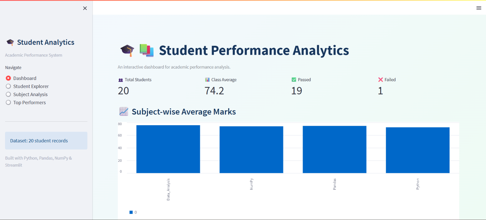
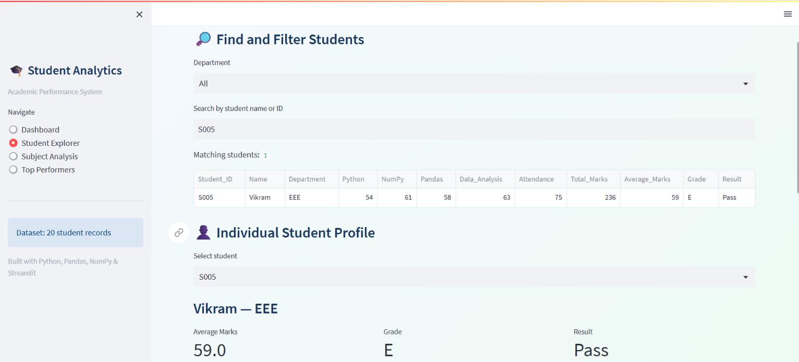
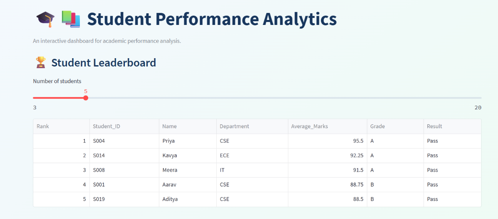
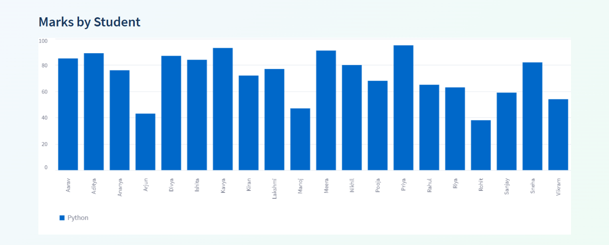

# 🎓 Student Performance Analytics System

An interactive student academic performance dashboard developed using Python, Pandas, NumPy, and Streamlit.

## 📌 Project Overview

The Student Performance Analytics System processes student marks and attendance data to generate useful academic insights. It calculates total marks and averages, assigns grades, determines pass/fail results, compares subject performance, and identifies top-performing students.

The project includes a Streamlit web interface that allows users to explore student records interactively and download analyzed data.

## 📸 Dashboard Preview



## 🎯 Objectives

- Analyze student academic performance using a CSV dataset.
- Calculate total and average marks using Python and NumPy.
- Assign grades based on student averages.
- Determine pass/fail results.
- Compare subject-wise performance.
- Identify the highest and lowest performers.
- Provide an interactive dashboard for data exploration.
- Generate downloadable CSV reports.
- Validate calculations through automated unit tests.

## 🛠️ Technologies Used

| Technology | Purpose |
|---|---|
| Python | Core application logic |
| Pandas | CSV loading and DataFrame analysis |
| NumPy | Numerical calculations |
| Streamlit | Interactive web dashboard |
| CSV | Input dataset and output reports |
| unittest | Automated testing |
| Git and GitHub | Version control and project hosting |

## ✨ Features

### 1. Dashboard
Displays total students, class average, pass count, fail count, subject-wise average marks, and performance charts.

### 2. Student Explorer
Search for students by name or student ID, filter records by department, and inspect individual student performance.



### 3. Subject Analysis
Explore subject-wise marks, averages, highest marks, lowest marks, and student comparisons.

### 4. Top Performers
View a leaderboard of students ranked by average marks.



### 5. CSV Downloads
Download the complete student analysis or filtered student records.

### 6. Automated Testing
Use unit tests to check calculation functions, grade assignment, pass/fail logic, and dataset analysis.

## 📊 Dataset

The dataset is stored in `data/students.csv` and contains 20 fictional student records.

| Column | Description |
|---|---|
| Student_ID | Unique student identifier |
| Name | Student name |
| Department | Student's department |
| Python | Python marks out of 100 |
| NumPy | NumPy marks out of 100 |
| Pandas | Pandas marks out of 100 |
| Data_Analysis | Data Analysis marks out of 100 |
| Attendance | Attendance value recorded in the dataset |

## 🧮 Analysis Rules

- **Total Marks:** Sum of marks in the four subjects.
- **Average Marks:** Total marks divided by four.
- **Grade A:** Average of 90 or above.
- **Grade B:** Average from 80 to below 90.
- **Grade C:** Average from 70 to below 80.
- **Grade D:** Average from 60 to below 70.
- **Grade E:** Average from 50 to below 60.
- **Grade F:** Average below 50.
- **Pass:** Every subject mark is at least 40.
- **Fail:** At least one subject mark is below 40.

## 📁 Project Structure

```text
student-performance-analytics/
├── data/
│   └── students.csv
├── outputs/
│   ├── student_analysis.csv
│   └── subject_summary.csv
├── screenshots/
│   ├── dashboard.png
│   ├── student_explorer.png
│   ├── top_performers.png
│   └── test_results.png
├── tests/
│   └── test_analysis.py
├── app.py
├── functions.py
├── main.py
├── requirements.txt
├── README.md
├── Project_Documentation.md
└── .gitignore
```

## ⚙️ Installation and Execution

### Prerequisites

Python and Git should be installed on your computer.

### 1. Clone the repository

```bash
git clone https://github.com/Sreevalli476/student-performance-analytics.git
cd student-performance-analytics
```

### 2. Install dependencies

```bash
python -m pip install -r requirements.txt
```

### 3. Launch the interactive dashboard

```bash
python -m streamlit run app.py
```

Open the local URL shown in the terminal, usually `http://localhost:8501`.

### 4. Run the terminal-based analysis

```bash
python main.py
```

### 5. Run the unit tests

```bash
python -m unittest discover -s tests -v
```

## 📄 Generated Reports

- `outputs/student_analysis.csv` — Student records with calculated totals, averages, grades, and results.
- `outputs/subject_summary.csv` — Subject-wise average marks.

The dashboard also provides CSV download buttons.

## 🧪 Test Results

The project includes seven unit tests covering total marks, average marks, grade assignment, pass/fail results, dataset analysis, and average correctness.



The project owner reported that all seven tests passed during testing.

## 📚 Learning Outcomes

- Reading and processing CSV datasets with Pandas.
- Using NumPy for numerical calculations.
- Creating reusable Python functions.
- Applying loops and conditional statements.
- Building interactive dashboards with Streamlit.
- Visualizing academic performance.
- Writing automated unit tests.
- Using Git and GitHub for version control.

## 👩‍💻 Author

**Sreevalli**

GitHub profile: https://github.com/Sreevalli476

## 🔗 Repository

https://github.com/Sreevalli476/student-performance-analytics

## 🏁 Conclusion

This project demonstrates how Python data-analysis libraries can be used to process student records and present academic insights through an interactive dashboard. It combines data processing, numerical calculations, visualization, automated testing, and report generation in one application.
